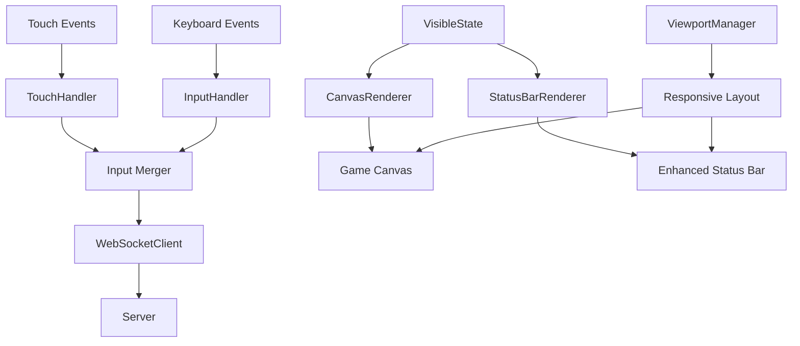

# 移动端触控支持设计文档

## 概述

本设计文档描述了为Color Blind Runner游戏添加移动端触控支持的技术实现方案。主要包括触摸手势检测、移动端界面适配、增强状态栏信息显示等功能。设计遵循现有的客户端架构，确保与键盘输入的兼容性。

## 架构

### 整体架构图



### 组件关系

- **TouchHandler**: 新增的触控输入处理器，与现有InputHandler并行工作
- **Input Merger**: 合并键盘和触控输入的逻辑层
- **StatusBarRenderer**: 增强的状态栏渲染器，显示详细游戏信息
- **ViewportManager**: 视口管理器，处理移动端适配

## 组件和接口

### TouchHandler 类

```typescript
/**
 * 触控输入处理器
 * 检测滑动手势并转换为游戏输入命令
 */
export class TouchHandler {
  private element: HTMLElement;
  private wsClient: WebSocketClient;
  private isEnabled: boolean = false;
  
  // 触控状态
  private touchStartX: number = 0;
  private touchStartY: number = 0;
  private touchStartTime: number = 0;
  private currentInput: PlayerInput;
  
  // 配置参数
  private readonly MIN_SWIPE_DISTANCE = 30; // 最小滑动距离(px)
  private readonly MAX_SWIPE_TIME = 300;    // 最大滑动时间(ms)
  private readonly DEBOUNCE_TIME = 50;      // 防抖时间(ms)
  
  constructor(element: HTMLElement, wsClient: WebSocketClient);
  
  // 公共方法
  bind(): void;
  unbind(): void;
  getCurrentInput(): Readonly<PlayerInput>;
  
  // 私有方法
  private handleTouchStart(event: TouchEvent): void;
  private handleTouchMove(event: TouchEvent): void;
  private handleTouchEnd(event: TouchEvent): void;
  private detectSwipeDirection(deltaX: number, deltaY: number, deltaTime: number): SwipeDirection | null;
  private updateInputFromSwipe(direction: SwipeDirection): void;
  private sendInputIfChanged(): void;
}
```

### Input Merger 逻辑

```typescript
/**
 * 输入合并器
 * 合并键盘和触控输入，处理优先级
 */
export class InputMerger {
  private keyboardInput: PlayerInput = { up: false, down: false, left: false, right: false };
  private touchInput: PlayerInput = { up: false, down: false, left: false, right: false };
  private wsClient: WebSocketClient;
  
  constructor(wsClient: WebSocketClient);
  
  updateKeyboardInput(input: PlayerInput): void;
  updateTouchInput(input: PlayerInput): void;
  
  private mergeInputs(): PlayerInput;
  private sendMergedInput(): void;
}
```

### StatusBarRenderer 类

```typescript
/**
 * 增强状态栏渲染器
 * 显示详细的游戏信息和统计数据
 */
export class StatusBarRenderer {
  private container: HTMLElement;
  private gameStats: GameStats;
  private isMobile: boolean;
  
  constructor(container: HTMLElement);
  
  // 渲染方法
  render(state: VisibleState, playerId: string): void;
  updateGameStats(stats: GameStats): void;
  setMobileMode(isMobile: boolean): void;
  
  // 私有渲染方法
  private renderBasicInfo(roomId: string, color: PlayerColor, playerCount: number, status: string): void;
  private renderGameStats(stats: GameStats): void;
  private renderDeathInfo(deathReason: string, finalStats: GameStats): void;
  private renderRankingInfo(ranking: PlayerRanking[]): void;
  private createStatItem(label: string, value: string, icon?: string): HTMLElement;
}
```

### ViewportManager 类

```typescript
/**
 * 视口管理器
 * 处理移动端适配和响应式布局
 */
export class ViewportManager {
  private canvas: HTMLCanvasElement;
  private statusBar: HTMLElement;
  private gameWrapper: HTMLElement;
  
  constructor(canvas: HTMLCanvasElement, statusBar: HTMLElement, gameWrapper: HTMLElement);
  
  // 公共方法
  init(): void;
  handleOrientationChange(): void;
  adjustForMobile(): void;
  
  // 私有方法
  private detectMobileDevice(): boolean;
  private calculateOptimalCanvasSize(): { width: number; height: number };
  private adjustStatusBarLayout(): void;
  private preventZoom(): void;
}
```

## 数据模型

### 触控相关类型

```typescript
// 滑动方向枚举
enum SwipeDirection {
  LEFT = 'left',
  RIGHT = 'right',
  UP = 'up',
  DOWN = 'down'
}

// 触控配置
interface TouchConfig {
  minSwipeDistance: number;
  maxSwipeTime: number;
  debounceTime: number;
  enableVerticalSwipe: boolean;
}

// 游戏统计数据
interface GameStats {
  distance: number;
  survivalTime: number;
  averageSpeed: number;
  maxSpeed: number;
  totalMoves: number;
  deathReason?: string;
  personalBest?: number;
}

// 玩家排名信息
interface PlayerRanking {
  playerId: string;
  playerColor: PlayerColor;
  distance: number;
  survivalTime: number;
  rank: number;
}

// 设备信息
interface DeviceInfo {
  isMobile: boolean;
  isTablet: boolean;
  screenWidth: number;
  screenHeight: number;
  pixelRatio: number;
  orientation: 'portrait' | 'landscape';
}
```

## 正确性属性

*属性是一个特征或行为，应该在系统的所有有效执行中保持为真——本质上是关于系统应该做什么的正式声明。属性作为人类可读规范和机器可验证正确性保证之间的桥梁。*

### 触控输入属性

**属性 1: 滑动手势检测**
*对于任何* 有效的左右滑动手势（距离 >= 30px，时间 <= 300ms），系统应该发送对应的移动输入命令到服务器
**验证: 需求 1.1, 1.2**

**属性 2: 输入停止一致性**
*对于任何* 触控输入序列，当触控结束时，系统应该停止发送移动命令
**验证: 需求 1.3**

**属性 3: 事件默认行为阻止**
*对于任何* 在游戏画布上的滑动手势，系统应该阻止页面滚动和其他默认触摸行为
**验证: 需求 1.4**

**属性 4: 输入合并正确性**
*对于任何* 同时存在的键盘和触控输入组合，最终发送的输入应该正确反映两种输入的逻辑或运算
**验证: 需求 1.5, 6.2**

### 响应式布局属性

**属性 5: 画布自适应**
*对于任何* 移动设备屏幕尺寸，游戏画布应该调整到适合屏幕的最优尺寸
**验证: 需求 2.1**

**属性 6: 方向变化适配**
*对于任何* 设备方向变化事件，界面布局应该重新调整以适应新的方向
**验证: 需求 2.2**

**属性 7: UI元素可见性**
*对于任何* 小屏幕设备，所有UI元素应该在视口范围内且可操作
**验证: 需求 2.3**

### 状态栏信息属性

**属性 8: 游戏状态信息完整性**
*对于任何* 游戏进行状态，状态栏应该包含距离、存活时间和移动速度信息
**验证: 需求 3.1**

**属性 9: 死亡状态信息显示**
*对于任何* 玩家死亡事件，状态栏应该显示死亡原因和最终统计数据
**验证: 需求 3.2**

**属性 10: 游戏结束排名显示**
*对于任何* 游戏结束状态，状态栏应该显示排名信息和个人最佳成绩对比
**验证: 需求 3.3**

**属性 11: 移动端状态栏适配**
*对于任何* 移动端设备，状态栏应该使用响应式布局正确显示
**验证: 需求 3.4**

### 触控反馈属性

**属性 12: 手势过滤一致性**
*对于任何* 不满足最小距离或最大时间要求的滑动手势，系统应该忽略该手势
**验证: 需求 4.2, 4.3**

**属性 13: 多点触控处理**
*对于任何* 多指触控事件，系统应该只处理第一个触控点
**验证: 需求 4.4**

**属性 14: 触控边界检查**
*对于任何* 超出游戏画布边界的触控事件，系统应该忽略该事件
**验证: 需求 4.5**

### 性能优化属性

**属性 15: 输入防抖**
*对于任何* 连续的触控输入事件，系统应该使用防抖机制限制发送频率
**验证: 需求 5.1**

**属性 16: 性能自适应**
*对于任何* 检测到的低性能设备，系统应该自动降低渲染质量
**验证: 需求 5.3**

### 兼容性属性

**属性 17: 键盘功能保持**
*对于任何* 现有的键盘输入功能，添加触控支持后应该保持完全不变
**验证: 需求 6.1**

**属性 18: 功能降级**
*对于任何* 不支持触控的设备，系统应该优雅降级到键盘模式
**验证: 需求 6.4**

**属性 19: 输入方式切换**
*对于任何* 输入方式的切换，游戏应该无缝过渡不中断
**验证: 需求 6.5**

## 错误处理

### 触控输入错误处理

1. **无效手势处理**
   - 滑动距离过短（< 30px）：忽略手势，不发送输入
   - 滑动时间过长（> 300ms）：忽略手势，避免误操作
   - 多指触控：只处理第一个触控点，忽略其他触控点

2. **设备兼容性错误**
   - 不支持触控的设备：自动禁用触控功能，使用键盘模式
   - 触控API不可用：优雅降级，显示键盘操作提示

3. **性能相关错误**
   - 低性能设备：自动降低渲染质量，减少动画效果
   - 内存不足：清理不必要的缓存，优化资源使用

### 响应式布局错误处理

1. **屏幕尺寸异常**
   - 极小屏幕（< 320px）：显示最小化UI，隐藏非必要元素
   - 极大屏幕（> 2560px）：限制最大画布尺寸，保持游戏体验

2. **方向变化错误**
   - 方向变化失败：回退到默认布局
   - 布局计算错误：使用安全的默认值

### 网络和性能错误处理

1. **网络连接问题**
   - 连接不稳定：降低输入发送频率
   - 延迟过高：启用输入预测和补偿

2. **电池和性能监控**
   - 电量低于20%：提示启用省电模式
   - 帧率低于30fps：自动降低渲染质量

## 测试策略

### 双重测试方法

本项目采用单元测试和基于属性的测试相结合的方法：

- **单元测试**: 验证特定示例、边界情况和错误条件
- **属性测试**: 验证通用属性在所有输入中的正确性
- **集成测试**: 验证组件间的交互和端到端流程

### 基于属性的测试配置

- **测试库**: 使用 `fast-check` 进行基于属性的测试
- **迭代次数**: 每个属性测试最少运行 100 次迭代
- **测试标签**: 每个测试使用注释标记对应的设计属性
  - 格式: `**Feature: mobile-touch-controls, Property {number}: {property_text}**`

### 测试覆盖范围

#### 单元测试重点
- 触控事件处理的具体示例
- 边界值测试（最小/最大滑动距离和时间）
- 错误条件处理
- 设备兼容性检查

#### 属性测试重点
- 滑动手势检测的通用性
- 输入合并逻辑的正确性
- 响应式布局的自适应性
- 性能优化的一致性

#### 集成测试重点
- 触控输入到服务器通信的完整流程
- 多种输入方式的协同工作
- 移动端和桌面端的兼容性
- 实际设备上的用户体验验证

### 测试环境配置

1. **模拟环境**
   - 使用 JSDOM 模拟浏览器环境
   - 模拟不同屏幕尺寸和设备类型
   - 模拟触控事件和手势

2. **真实设备测试**
   - iOS Safari 测试
   - Android Chrome 测试
   - 不同屏幕尺寸的设备测试

3. **性能测试**
   - 内存使用监控
   - 帧率性能测试
   - 网络延迟模拟测试